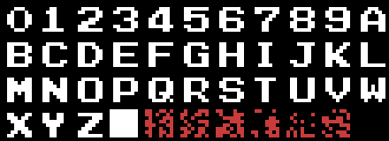

# Curiosities

## The debug keys

Byte **`0x4032`** of the cartridge header is 0xFF. Two routines check it
before doing anything (`p00:441E` and `p01:64E8`): with any other value, the
game has debug keys.

- **F3 when the game starts**: the ship does not collide with anything (bit 0
  of `0xCA03`, checked by `p02:8060`).
- **F4 while playing**: the stage is considered finished and the next one
  starts (`p00:442C` clears the stage script).

Behind them there is a third one, `p00:4432`: with F3 while playing, the next
restart point (`0xCA1E`, 0 to 5) and one more life. Nothing calls it.

Without debugging two function keys remain in plain sight: **F1** pauses the
game (`p00:4453`, with sounds 0x82 and 0x81) and **F5** continues after game
over (`p01:6399`: the "CONTINUE TO F5").

## The demo recorder

The three demos shown after the story are recorded in **bank 31**: triplets
[frames][controls][just pressed] that `p01:789C` reads as if they were the
controls (`0xC908` and `0xC907`). Each one says its stage and its restart
point (`p01:7877`).

`0xC91F` chooses where they come from (`p01:7883`): with 0, from bank 31;
with **1, they are recorded** while playing, triplet by triplet, into the RAM
of slot 0x88 from `0x4000` (`p01:7905`, with the BIOS routine WRSLT); with 2,
they are read from there (RDSLT). It is the tool they were recorded with: in
the cartridge nothing writes to `0xC91F`, so it is always 0.

## The disk and bank 31

In bank 2's jump table there is an entry, `0x800C`, that nothing calls:
**`p02:8F64`**. It only does something if there is a disk drive (the H.PHYD
hook is not a `ret`): it removes the interrupt, swaps the RAM of page 1 with
that at `0xC000` and the RAM at `0x5000` with that at `0xD000`, puts bank 31 at
`0x6000` and jumps there. The way back, `p02:8FC5` (entry `0x800F`), undoes
it. But bank 31 holds the recorded demos, not code: most likely something else
was there during development (a loader or a monitor) and the entry stayed. It
is an **open question**.

## The page viewer

`p10:808E` is another tool nobody calls: with the cursor keys it moves the
screen up and down (register 23) and with keyboard rows 2 and 3 it chooses
which of the seven character pages is shown (`p10:80F8`). Nothing reaches it.

## The V9958

When setting up each stage, `p09:6D30` checks whether the VDP is a **V9958**
(the MSX2+ one): if it is, it sets register 25 to 2 (the MSK bit), which hides
the first 8 dots on the left: the column that register 18's horizontal
adjustment moves when scrolling. The MSX2's V9938 has no such register and the
column is seen.

## A stage without graphics

The graphics list of **stage 8** (`p10:9156`) is empty: the stage is seen with
the characters stage 7 left behind. Starting it directly (something the game
does not allow) it would show whatever VRAM there was.

## The tune that never repeats

The one for **stage 3** (0x3D) never sounds the same twice: seven of its
channels start again every 2,760 frames and the second PSG channel every
2,770, so each round is ten frames further out of step than the last.

## The two stories

The story text is there twice: `p01:615D` says "IN 189.S.D. / DANGER
THREATENED OUR GALAXY." and `p03:BEEB` says "IN THE SD.189 / DANGER THREATEND /
OUR GALAXY", with the typo. Only the first is seen (see
[The texts](THE-TEXTS.html)).

## A font nobody loads

`p01:64F6` is a routine nothing reaches: in the cartridge's 256 KB there is
no call, jump or pointer with its address, and none of the games played runs
it. It sends to VRAM sixteen solid squares, one of each colour (the character
at `p01:665C`), the BIOS letters from the space onwards, and a font that is
nowhere else in the cartridge, the one at `p01:653C`: the ten digits, the
twenty-six letters and a solid square. It asks for 0x2B letters (`p01:6525`),
43, and the font has 37: the six left over are the code that follows (in red).

## Bug hunt

- **The first interrupt.** At power-on, `p00:4063` clears the game's RAM from
  `0xC000` to `0xF0EF`, leaving out `0xF0F0` onwards, where the stage and the
  lives are kept for continuing (`0xF0FC` and `0xF0FD`). But the copies of the
  banks in place are there too (`0xF0F0-0xF0F3`), and the interrupt saves them
  on entry and puts them back in the mapper on exit (`p00:4126` and
  `p00:4136`). The first time nobody has written them: the mapper gets whatever
  the RAM held at power-on. Nothing happens, because the program is waiting in
  bank 0 (`p00:4307`) and whoever uses another bank sets it first. It is the
  only read of unwritten RAM found playing the whole cartridge: the intro, the
  nine stages and the game over (`tools/ram_sin_escribir.py`).
- **The font at `p01:64F6`** copies six letters too many (above), but nobody
  calls it.
- **Stage 3's tune** drifts every round (above).
- Conditional jumps that are always or never taken: none (the series'
  `saltos_imposibles.py`). The six doubtful cases from `caza_bugs.py` (an
  `inc` or `dec` between what sets the flag and the jump) are on purpose:
  those instructions do not touch the flag being tested.

## Open questions

- What was in bank 31 when `p02:8F64` was written.
- Who set `0x4032` to another value: in the cartridge, nobody.
