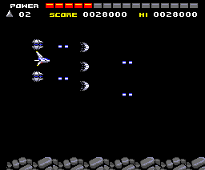
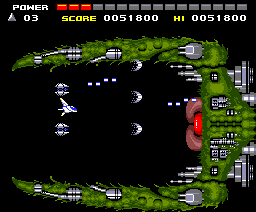
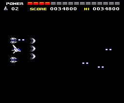
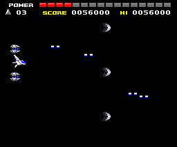
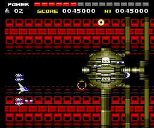
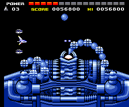
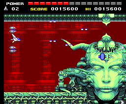
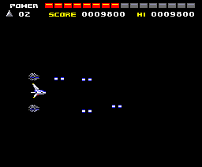
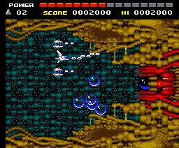

# The bosses

One boss per stage, at the end of its map. The fight starts when the map
brings the order that **stops the scroll**: 0x14 or 0x1E set `0xC0D4` (the
frame stops moving the scroll and loads the boss graphics, the list at
`p10:8177` + 2 x stage, `p09:6D95`) and 0x16 freezes the scroll (`0xC0D6`). It
ends when the stage is considered done (`0xCA0F`, `p00:440F`), and `p01:6312`
moves on to the next one: **the bosses come in stage order**.

Almost all of them have their own tune, 0x39, which the map itself asks for
when it ends (`p09:6DA7`); the stage 7 one has another, 0x42 (`p05:8EA3`),
and in stage 9 the stage tune goes on. When they are beaten 0x4D plays
(`p04:7CDC`), and 0x52 in stage 7. See [The music](THE-MUSIC.html).

## How they are made

Each fight is **played by the running cartridge** (`tools/jefes.py`): the
stage with the ship invincible, firing and moving up and down by itself; so
that it does not last for minutes, when the stage starts it picks up the
capsules the game hands out in their order (nine power ones, the three-way
shot and two options; see [The ship](THE-SHIP.html)). The GIF goes from the
moment the scroll stops until the stage ends, whole, at the
MSX's pace (measured in openMSX, see [Under the hood](UNDER-THE-HOOD.html)).

Stage 8 loads no graphics of its own: it is played coming from stage 7, as in
the game (starting it directly, its boss would not be seen).

## The nine

| Stage | The fight | |
|---|---|---|
| 1 | 70 s |  |
| 2 | 22 s |  |
| 3 | 44 s |  |
| 4 | 52 s |  |
| 5 | 55 s |  |
| 6 | 182 s, the longest |  |
| 7 | 83 s, with its own tune |  |
| 8 | 68 s, coming from stage 7 |  |
| 9 | 70 s; when it is beaten, the [ending](THE-SEQUENCES.html) |  |
