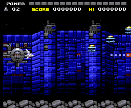
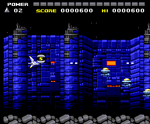
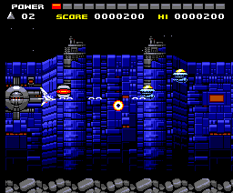
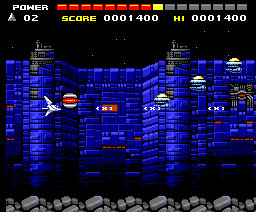
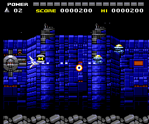
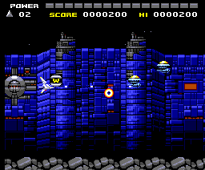
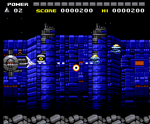
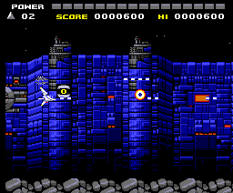
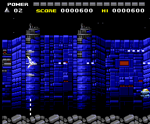
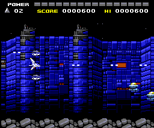

# La nave

La nave es la ficha de `0xCA40`; sus dos opciones, las de `0xCAC0` y `0xCAE0`;
sus disparos, las ocho de 0x20 bytes de `0xCC40`. Lo que lleva puesto son cinco
**casillas de armas** de 8 bytes desde `0xCB40` (`p02:84C0`): el arma
principal, la de las armas 1, 5 y de la 9 en adelante (`0xCB48`), y las de las
opciones (`0xCB50` y `0xCB58`). Cada casilla tiene el arma y su nivel; el
nivel elige cómo dispara (`p02:85FD`, la tabla `p02:8608`).

## Las cápsulas

Las mejoras salen en **cápsulas** (el actor de tipo 3) que sueltan los
portadores al romperse (`p05:9A5C` llama a `p04:6F55`). No se eligen: salen
**siempre en el mismo orden**, el de la lista `p04:7042`, y `0xCC01` recuerda
la última. La cápsula es una pieza de caracteres del fondo (`p04:7049`), y la
nave la coge al tocarla (`p02:875F`: el bit 5 del carácter; `p02:87BF`).

| Orden | Cápsula | Lo que hace (`p02:83B8`) |
|---|---|---|
| 1 | 0x02 | más velocidad (`0xCB01`, hasta 4) |
| 2 | 0x0E | más potencia del disparo (`0xCB08`, hasta 16; baja sola con el tiempo, `p02:8530`) |
| 3 | 0x03 | el misil que va por el suelo (el arma 0x80 en `0xCB48`) |
| 4 | 0x07 | una opción (hasta dos) |
| 5 | 0x0A | el disparo triple (nivel 10 en las armas) |
| 6 | 0x0B | la bomba: el siguiente disparo la lanza |

Y vuelta a empezar. Tres se cambian por otra si ya no sirven (`p04:6FF7`):
con el misil puesto, la 3 sale como 0x0E; con el disparo triple, la 0x0A sale
como **0x0C**, que devuelve el disparo sencillo; y con las dos opciones, la 7
sale como 0x0E. La 0x0D solo suena, y ninguna de la lista la da.

El **botón 2** (la tecla M o el segundo botón del mando) cambia la formación
de las opciones (`p02:8569`: encima de la nave, delante o detrás) y con ella
el arma de cada opción (la tabla `p02:8590`).

## Cada una, jugada

Los GIF los pinta el cartucho ejecutado (`tools/armas.py`): la fase 1 con la
nave invencible y disparando, y la cápsula pedida con la rutina del propio
cartucho que las crea (`p04:6F55`), delante de la nave, que la recoge sola.
Mientras se graba, las cápsulas que suelta el juego se quitan, para que cada
GIF enseñe solo lo suyo. Van al ritmo del MSX: jugando, el juego procesa un
cuadro cada 3,47 del VDP (medido en openMSX, ver [Por dentro](POR-DENTRO.html)).

| | |
|---|---|
| **El disparo de salida** (arma 1, nivel 1) |  |
| **Velocidad** (cuatro cápsulas 0x02) |  |
| **Potencia 1** (una cápsula 0x0E: el disparo cambia de dibujo, `p02:871E`) |  |
| **Potencia 2** (nueve cápsulas 0x0E) |  |
| **El misil** (0x03, `p02:8E50`: sale hacia abajo y sigue el suelo) |  |
| **El disparo triple** (0x0A, `p02:8BF1`) |  |
| **Una opción** (0x07) |  |
| **Dos opciones, formación 0** |  |
| **Dos opciones, formación 1** (el botón 2 una vez) |  |
| **Dos opciones, formación 2** (el botón 2 dos veces) |  |
| **La bomba** (0x0B, `p02:8816`: dos bombas que al estallar dan a todo lo que hay en pantalla) |  |
