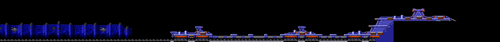
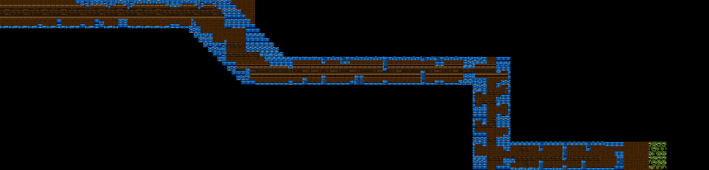
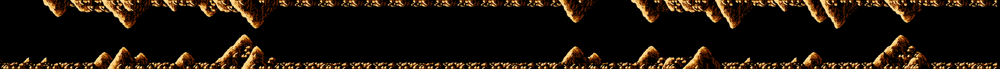
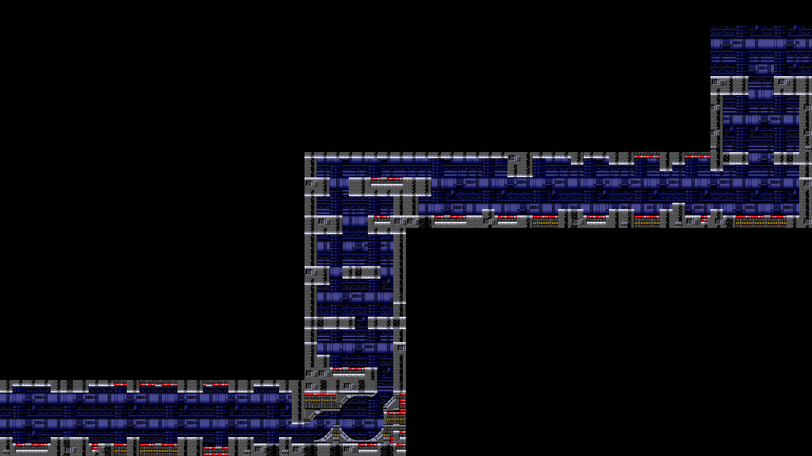
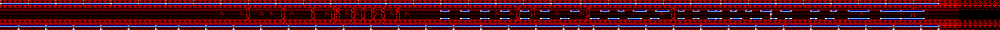
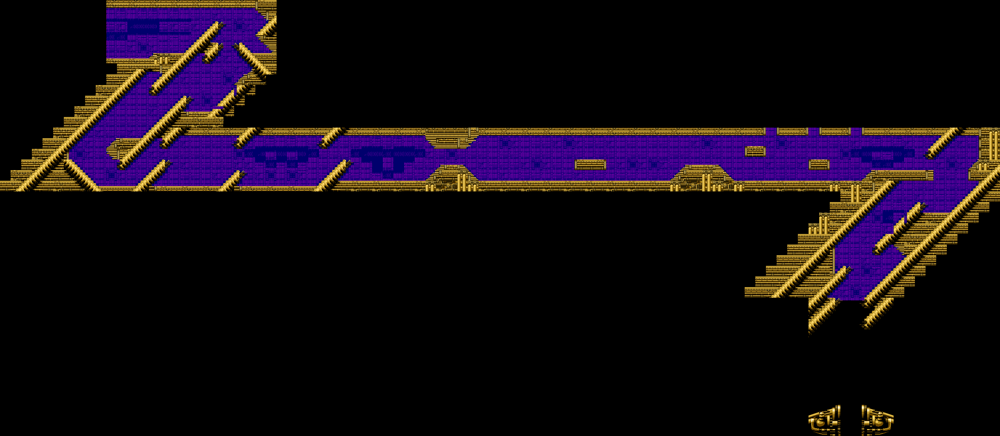
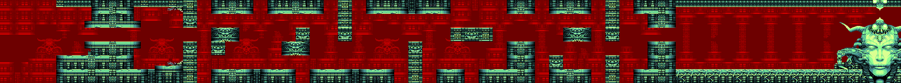
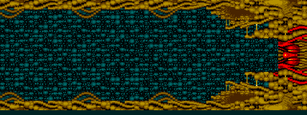

# Las fases

Las nueve fases, **enteras y dibujadas desde la ROM** por `tools/recorrido.py`:
el motor del mapa del banco 9 rehecho en Python, que lee los mismos bytes que
lee el cartucho y en el mismo orden, y en lugar de pintar en el mapa de 64 x 32
caracteres de `0xE000` (que da la vuelta) pinta en un lienzo sin bordes. Los
caracteres son los que carga el propio cartucho al empezar la fase
(`tools/vram.py`, el cargador del banco 10), y los colores, los de sus listas y
los que cambia el mapa por el camino.

No es una captura: está **cotejado casilla a casilla** con lo que el cartucho
ejecutado tiene en pantalla en cada fase (`tools/coteja_dibujo.py`): en las
casillas del mapa (las que no tapan piezas de enemigos ni estrellas) el dibujo
de 8 x 8 sale igual en todas, 0 distintas, con la página de caracteres que el
VDP tenía puesta en cada momento. La VRAM que deja el cargador es la del
cartucho byte a byte.

## Cómo avanza una fase

El mapa de las nueve fases está en el **banco 27**; la tabla `p09:7C8C` da
dónde empieza cada una, con hasta seis puntos de salida (donde se vuelve a
empezar al perder una vida: la orden 0x1A los va contando en `0xCA1E`). Cada
byte del mapa es un **bloque de 4 x 4 caracteres** de la tabla de la fase
(`p09:7D76`, 16 bytes por bloque, en los bancos 25 y 26).

El scroll va por **tramos** (la tabla `p09:78FF`, 12 bytes cada uno): la
velocidad en Y y en X, cada cuánto entra una columna o una fila nueva y cómo se
pinta (`0xC0CE`, tabla `p09:7C5B`): una columna de 6 bloques por la derecha,
una fila de 8 por arriba o por abajo, o una fila de 15 para los tramos en
diagonal. Cada cuatro columnas el mapa avanza 6, 8 o 15 bytes.

Un byte 0xFF trae una **orden** (`p09:7858`): por debajo de 0x10, un tramo
nuevo; de 0x10 a 0x1F, las 16 de `p09:7874`: saltar a otra parte del mapa si
se ha roto una pieza (`0xCE4C`), cambiar la página de caracteres y el
desplazamiento vertical del VDP, los colores, la música, contar un punto de
salida, esperar a un fundido... El mapa de cada fase acaba en la orden que
**para el scroll para el jefe**: la 0x14 o la 0x1E (`0xC0D4`: el cuadro deja
de mover el scroll y carga los gráficos del jefe, `p09:6D95`) o la 0x16
(`0xC0D6`, el scroll quieto).

Las **páginas** son siete juegos de caracteres en la VRAM (`p10:80F8`): la
orden 0x11 cambia de una a otra mientras la fase sigue, y en la fase 5 el
cuadro las va pasando solo (0, 1, 2, 3, 2, 1: el fondo se anima; en la 9, cada
cuatro cuadros, `p09:6D95`). Como la
página es de toda la pantalla, en el dibujo cada casilla va con la que más
tiempo estuvo a la vista.

## Las nueve

Los tramos de cada una, en orden (el número es la entrada de `p09:78FF`):

| Fase | Tramos | El scroll | Columnas |
|---|---|---|---|
| 1 | 0, 0, 4, 0, 11, 0 | a la derecha; en diagonal hacia arriba; a la derecha; en diagonal hacia abajo, al doble; a la derecha | 556 |
| 2 | 0, 0, 1, 0, 0, 3, 0 | a la derecha; en diagonal hacia abajo; a la derecha; hacia abajo; a la derecha | 672 |
| 3 | 9, 9, 9, 9 | a la derecha, despacio | 344 |
| 4 | 9, 6, 9, 9, 6 | a la derecha, despacio; hacia arriba; a la derecha; hacia arriba | 376 |
| 5 | 8, 8, 8 | a la derecha, al doble de la 1 | 800 |
| 6 | 0, 5, 9, 9, 5, 3 | a la derecha; en diagonal hacia abajo y a la izquierda; a la derecha; otra vez en diagonal; hacia abajo | 524 |
| 7 | 9 | a la derecha, despacio | 256 |
| 8 | 9 | a la derecha, despacio | 176 |
| 9 | 9 | a la derecha, despacio, y enseguida el jefe | 64 |

La **fase 8** no trae gráficos propios (su lista, `p10:9156`, está vacía): se
ve con los caracteres que dejó la 7. Cotejado jugando de la 7 a la 8: 0 bytes
distintos en la VRAM.

### Fase 1

### Fase 2

### Fase 3

Las rocas que se rompen (los caracteres 0xA7 a 0xAE, `p02:86CB`) no son del
mapa: las ponen los enemigos, y no salen aquí.

### Fase 4

### Fase 5

### Fase 6

### Fase 7

### Fase 8

### Fase 9

