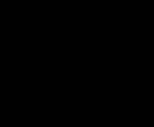

# Las secuencias

La presentación y el final, **enteros y al ritmo del MSX**, pintados por el
cartucho ejecutado (`tools/secuencias.py`).

El cartucho ejecutado aquí hace las órdenes del VDP al instante y el MSX
espera a que acaben: la historia dura en el MSX 7.414 cuadros y aquí 1.786, y
el final 15.067 y aquí 2.258. Por eso cada imagen lleva el **tiempo medido en
openMSX** (`tools/omsx_ritmo.tcl`): se toman marcas que los dos tienen (los
cambios de estado y de paso, cada cuadro que procesa el bucle principal y, en
el final, cada cambio en los guiones de los objetos del motor de secuencias,
`0xE100`) y, entre dos marcas, el tiempo medido se reparte a partes iguales.
En la presentación salen 597 marcas comunes y en el final 1.499; las dos duran
lo que en openMSX.

## La presentación

El logotipo de Konami, el título (que sube con el registro 23, `p01:6994`) y
la historia: la secuencia de `p03:A65B`, con el texto de `p01:615D` (ver
[Los textos](LOS-TEXTOS.html)) y la música 0x4A. Dura 2 minutos y 27 segundos.

## El final

Tras el jefe de la fase 9 (`0xCA10` = 9): la nave sobre un planeta,
los créditos (`p03:BDE7`) y la música 0x49. Al acabar empieza la
segunda vuelta: la fase 1 otra vez (`0xCA04` cuenta las vueltas; con ella sube
el nivel que elige la rapidez de las balas, `p02:83E7`). Dura
4 minutos y 11 segundos.

Para llegar se empieza en la fase 9 y se da por acabada (`0xCA0F` = 1, lo que
deja su jefe al morir); lo demás lo hace el cartucho.

## La demostración no está

Tras la historia salen tres demostraciones grabadas (ver
[Curiosidades](CURIOSIDADES.html)). No están aquí porque el cartucho ejecutado
no las reproduce igual que el MSX: con las mismas entradas grabadas, en
openMSX la primera llega a su final (1.285 cuadros de juego) y aquí la nave
muere en el 667. El juego no depende de nada al azar que no sea suyo
(`p00:4678` lee sus propios bytes), así que algo de lo que hace el emulador no
casa con el MSX en esas partidas. Es una **pregunta abierta**.
