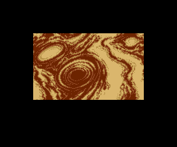

# Las secuencias

La presentación y el final, **enteros y al ritmo del MSX**, pintados por el
cartucho ejecutado (`tools/secuencias.py`), y las tres demostraciones,
grabadas en openMSX.

El cartucho ejecutado aquí hace las órdenes del VDP al instante y el MSX
espera a que acaben: la historia dura en el MSX 7.414 cuadros y aquí 1.786, y
el final 15.067 y aquí 2.258. Por eso cada imagen lleva el **tiempo medido en
openMSX** (`tools/omsx_ritmo.tcl`): se toman marcas que los dos tienen (los
cambios de estado y de paso, cada cuadro que procesa el bucle principal y, en
el final, cada cambio en los guiones de los objetos del motor de secuencias,
`0xE100`) y, entre dos marcas, el tiempo medido se reparte a partes iguales.
En la presentación salen 597 marcas comunes y en el final 1.499; las dos duran
lo que en openMSX.

## La presentación

El logotipo de Konami, el título (que sube con el registro 23, `p01:6994`) y
la historia: la secuencia de `p03:A65B`, con el texto de `p01:615D` (ver
[Los textos](LOS-TEXTOS.html)) y la música 0x4A. Dura 2 minutos y 27 segundos.

## El final

Tras el jefe de la fase 9 (`0xCA10` = 9): la nave sobre un planeta,
los créditos (`p03:BDE7`) y la música 0x49. Al acabar empieza la
segunda vuelta: la fase 1 otra vez (`0xCA04` cuenta las vueltas; con ella sube
el nivel que elige la rapidez de las balas, `p02:83E7`). Dura
4 minutos y 11 segundos.

Para llegar se empieza en la fase 9 y se da por acabada (`0xCA0F` = 1, lo que
deja su jefe al morir); lo demás lo hace el cartucho.

## Las demostraciones

Tras la historia salen tres demostraciones grabadas (ver
[Curiosidades](CURIOSIDADES.html)), una cada vez: `0xC919` pasa de una a otra
y la tabla `p01:7877` da la fase y el punto de salida de cada una. Salen en
este orden: la **fase 1** desde su segundo punto de salida, la **fase 2**
desde el tercero y la **fase 4** desde el principio.

Estas no las pinta el cartucho ejecutado (ver abajo por qué): están
**grabadas en openMSX**, que las reproduce como el MSX
(`tools/omsx_graba_demo.tcl`, lanzado con `tools/lanza_graba_demo.ps1`). En
cada cuadro del VDP se vuelcan la VRAM, la paleta y los registros de los tres
tramos de la pantalla (el marcador y las dos partes de abajo, que cambian las
dos interrupciones de línea), y `tools/demo_omsx.py` pinta cada cuadro con el
mismo dibujador que los demás GIF. Cada imagen dura lo que en openMSX: un
cuadro del VDP, 1/60 de segundo. Para grabar la segunda y la tercera sin
esperar a que salgan, se escribe en `0xC919` al llegar al título.

### La primera: fase 1 (1 minuto y 18 segundos)

### La segunda: fase 2 (1 minuto y 2 segundos)

### La tercera: fase 4 (1 minuto y 17 segundos)

### Cómo se ha cotejado

- **Con capturas de pantalla de openMSX** en tres cuadros (el 600, el 1.500 y
  el 3.000 de la primera): **0 puntos distintos**. Para llegar ahí hubo que
  arreglar dos cosas del dibujador, que valen también para los demás GIF de
  la web (rehechos con ellas): el ajuste horizontal del registro 18 corre
  **también los sprites**, no solo el fondo; y los registros de las
  interrupciones de línea **llegan tarde**: la `otir` acaba 4,36 líneas
  después de la primera interrupción y 3,2-3,4 después de la segunda (medido
  en openMSX, `tools/omsx_lineas.tcl`), así que bajo el marcador quedan seis
  líneas negras.
- **Con el cartucho ejecutado**, los 68 primeros cuadros de juego de la
  primera (`tools/coteja_demo_omsx.py`), la imagen del último cuadro del VDP
  de cada uno: **35 salen iguales punto a punto**. Desde el cuadro 6 la VRAM
  solo difiere en las tablas que se alternan con la interrupción (`0xC09B`):
  las de nombres (`0xC000-0xC7FF`) y las de sprites (`0xF000-0xFFFF`). En la
  imagen se ve en la barra de POWER y en una torreta del acorazado, y además en
  el fundido de la paleta (cuadros 8 a 17) y en el cuadro en que se carga la
  pantalla (el 5). Es lo que ya se sabía que mueve la interrupción (ver
  abajo).

### Por qué no las pinta el cartucho ejecutado

Con las mismas entradas grabadas, en openMSX la primera llega a su final
(1.285 cuadros de juego) y aquí la nave muere en el 667.

Está medido dónde se separan (`tools/coteja_demo.py`, con la RAM de openMSX al
empezar cada cuadro de juego, `p01:6256`): **hasta el cuadro 67 la partida es
la misma** en los dos. Lo único distinto es lo que mueve la interrupción: el
motor de sonido y su cola (`0xC600-0xC8A2`), el fundido de la paleta
(`0xEF00`) y la alternancia de las tablas de sprites y de líneas y de la
página de caracteres (`0xC09B-0xC0B5`). En el **cuadro 68** un disparo da a un
enemigo en el MSX (`0xCF04` = 3) y aquí sigue volando (`0xCC40`), y desde ahí
las dos partidas van cada una por su lado.

En el MSX cada cuadro de juego dura 3 o 4 del VDP (medido en openMSX), y
aquí, contando por instrucciones y con las órdenes del VDP instantáneas,
casi siempre 3. Pero el ritmo **no es la causa**, medido: con las órdenes del
VDP tardando lo suyo (`--tiempos`) y luego con el Z80 contado por ciclos de
reloj, con la espera M1 del MSX y las interrupciones de línea en su línea
(`--ciclos`, `tools/ciclos.py`), los cuadros de juego pasan a durar 3, 4, 5 o
6 del VDP y la partida se separa **en el mismo cuadro 68 y con los mismos
bytes**. Lo que lo decide es otra cosa, y sigue siendo una **pregunta
abierta**.
