# Los enemigos

Cada enemigo es un **actor**: una ficha de 0x40 bytes en `0xCE80` (20) o
de 0x20 en `0xD460` (18), con su tipo en el primer byte. Cada tipo tiene su
puesta en marcha y lo que hace en cada cuadro en dos tablas (`p04:6360` y
`p04:64D1`); los dibuja `p04:7791` con sprites o con piezas de caracteres del
fondo (`p04:7A5F`). Los pone en la fase su guion (`p04:625E`), que mira por
dónde va el scroll (`0xCA34`).

Los GIF los **juega el cartucho** (`tools/enemigos.py`): la fase con la nave
invencible y **sin disparar**, para que cada enemigo haga su recorrido entero,
desde el cuadro en que sale cada tipo por primera vez. Cuando varios tipos
salen seguidos van en el mismo GIF (una **oleada**: los que aparecen en sus
primeros 120 cuadros), con la lista de los que estrenan. Pantalla entera y al
ritmo del MSX (ver [Por dentro](POR-DENTRO.html)). En el cartucho no hay
nombres de enemigos: van por su número de tipo.

Debajo de cada fase, **cada tipo suelto**, en la fase en que sale por primera
vez (`tools/enemigo_suelto.py`): en un cuadro en que se ve, la partida se
copia y en la copia se quita ese tipo; lo que cambia entre las dos pantallas
tres cuadros después es lo que él dibuja, y el recorte es esa zona (a tres
aumentos, con lo que haya alrededor). Los que van en las fichas de `0xD460`
son **balas** para el juego (`p04:7840`); los que al quitarlos no cambia nada
no dibujan por sí mismos (ponen en marcha a otros), y hay alguno que al
quitarlo cambia la pantalla entera.

Los jefes están en [Los jefes](LOS-JEFES.html); las cápsulas (el tipo 3), en
[La nave](LA-NAVE.html).

## Fase 1

| Salen | |
|---|---|
| tipos 0x12, 0x10 | 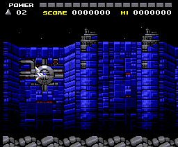 |
| tipos 0x1E, 0x67, 0x18 | 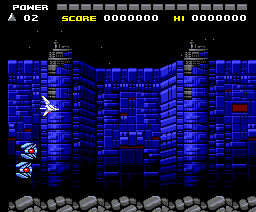 |
| tipos 0x62, 0x15, 0x61 | 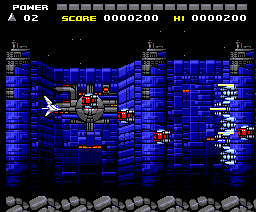 |
| tipo 0x1F | 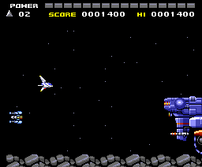 |
| tipos 0x60, 0x22, 0x20, 0x70, 0x55, 0x26, 0x11, 0x68 | 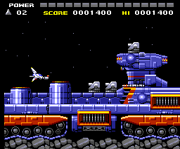 |
| tipo 0x56 | 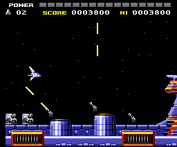 |
| tipos 0x64, 0x3D, 0x40 | 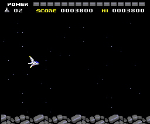 |

| Tipo | Suelto | |
|---|---|---|
| 0x12 | 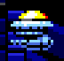 |  |
| 0x10 | 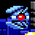 |  |
| 0x1E | 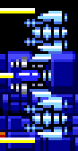 |  |
| 0x67 |  | bala |
| 0x18 | 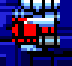 |  |
| 0x62 | 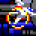 |  |
| 0x15 | 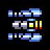 |  |
| 0x61 | 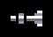 | bala |
| 0x1F | 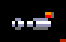 |  |
| 0x22 | 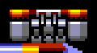 |  |
| 0x20 | 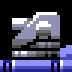 |  |
| 0x70 |  |  |
| 0x26 | 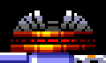 |  |
| 0x11 | 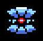 |  |
| 0x55 |  |  |
| 0x60 |  | bala |
| 0x68 | 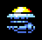 |  |
| 0x56 |  |  |
| 0x64 |  | cambia la pantalla entera |
| 0x3D | 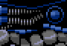 |  |
| 0x40 | 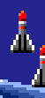 |  |

## Fase 2

| Salen | |
|---|---|
| tipos 0x12, 0x19, 0x62, 0x10, 0x60 | 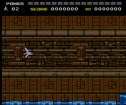 |
| tipos 0x18, 0x29, 0x03, 0x27 | 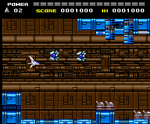 |
| tipos 0x2E, 0x2C, 0x67 | 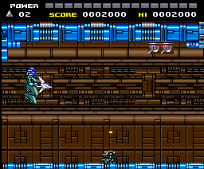 |
| tipos 0x2B, 0x16 | 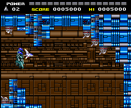 |
| tipo 0x2D | 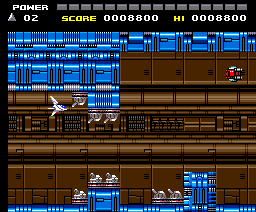 |
| tipo 0x31 | 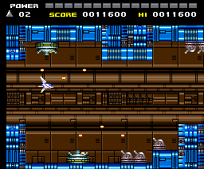 |
| tipos 0x2A, 0x2F | 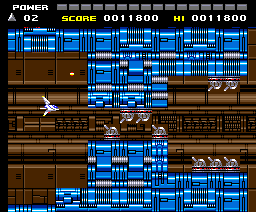 |
| tipos 0x3C, 0x3B, 0x7A | 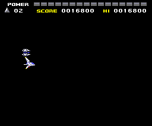 |

| Tipo | Suelto | |
|---|---|---|
| 0x19 | 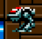 |  |
| 0x29 | 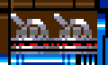 |  |
| 0x03 | 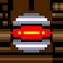 |  |
| 0x27 | 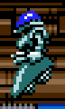 |  |
| 0x2E | 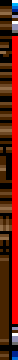 |  |
| 0x2C | 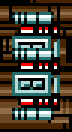 |  |
| 0x2B | 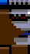 |  |
| 0x16 | 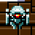 |  |
| 0x2D | 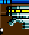 |  |
| 0x31 | 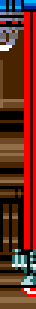 |  |
| 0x2A | 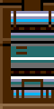 |  |
| 0x2F | 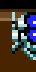 |  |
| 0x3C |  |  |
| 0x7A | 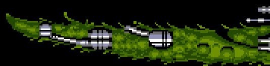 |  |
| 0x3B | 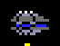 |  |

## Fase 3

| Salen | |
|---|---|
| tipos 0x60, 0x13, 0x32, 0x62 |  |
| tipos 0x03, 0x1C, 0x1D, 0x18, 0x67 | 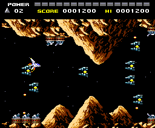 |
| tipo 0x27 | 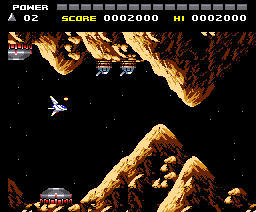 |
| tipos 0x35, 0x75 | 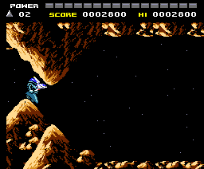 |
| tipo 0x33 | 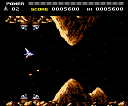 |
| tipo 0x28 | 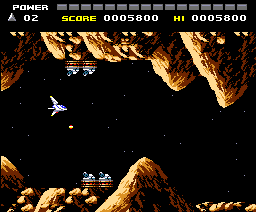 |
| tipo 0x45 | 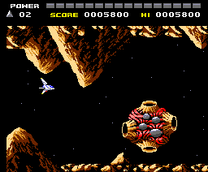 |
| tipos 0x3F, 0x3E |  |

| Tipo | Suelto | |
|---|---|---|
| 0x13 |  |  |
| 0x32 |  |  |
| 0x1C |  |  |
| 0x1D |  |  |
| 0x35 |  |  |
| 0x75 |  | bala |
| 0x33 |  |  |
| 0x28 |  |  |
| 0x45 |  |  |
| 0x3F |  |  |
| 0x3E |  |  |

## Fase 4

| Salen | |
|---|---|
| tipos 0x19, 0x60, 0x17 |  |
| tipo 0x67 |  |
| tipo 0x6F |  |
| tipo 0x62 |  |
| tipo 0x37 |  |
| tipos 0x38, 0x6E |  |
| tipo 0x2D |  |
| tipo 0x58 (ya con el jefe) |  |

| Tipo | Suelto | |
|---|---|---|
| 0x17 |  |  |
| 0x6F |  |  |
| 0x37 |  |  |
| 0x38 |  |  |
| 0x6E |  |  |
| 0x58 |  |  |

## Fase 5

| Salen | |
|---|---|
| tipos 0x18, 0x62, 0x27 |  |
| tipos 0x41, 0x49, 0x03 |  |
| tipos 0x13, 0x60 |  |
| tipo 0x21 |  |
| tipos 0x76, 0x5F |  |

| Tipo | Suelto | |
|---|---|---|
| 0x41 |  |  |
| 0x49 |  |  |
| 0x21 |  |  |
| 0x5F |  | no dibuja nada |
| 0x76 |  |  |

## Fase 6

| Salen | |
|---|---|
| tipos 0x4D, 0x2F, 0x48 |  |
| tipos 0x62, 0x03, 0x4A |  |
| tipos 0x44, 0x60 |  |
| tipo 0x0E |  |
| tipos 0x73, 0x17, 0x67 |  |
| tipos 0x7C, 0x7B, 0x0D |  |

| Tipo | Suelto | |
|---|---|---|
| 0x4D |  |  |
| 0x48 |  |  |
| 0x4A |  |  |
| 0x44 |  |  |
| 0x0E |  |  |
| 0x73 |  |  |
| 0x7C |  |  |
| 0x7B |  |  |
| 0x0D |  |  |

## Fase 7

| Salen | |
|---|---|
| tipos 0x4D, 0x4F, 0x60 |  |
| tipos 0x16, 0x62, 0x1A |  |
| tipo 0x03 |  |
| tipos 0x43, 0x23 |  |

| Tipo | Suelto | |
|---|---|---|
| 0x4F |  |  |
| 0x1A |  |  |
| 0x43 |  |  |
| 0x23 |  |  |

## Fase 8

| Salen | |
|---|---|
| tipos 0x50, 0x42, 0x1B |  |
| tipo 0x60 |  |
| tipo 0x62 |  |
| tipo 0x78 (ya con el jefe) |  |
| tipo 0x74 (ya con el jefe) |  |

| Tipo | Suelto | |
|---|---|---|
| 0x50 |  |  |
| 0x42 |  |  |
| 0x1B |  |  |
| 0x78 |  |  |
| 0x74 |  |  |

## Fase 9

| Salen | |
|---|---|
| tipos 0x5A, 0x4E, 0x62 |  |
| tipos 0x79, 0x66, 0x5E, 0x4C |  |

| Tipo | Suelto | |
|---|---|---|
| 0x4E |  |  |
| 0x5A |  |  |
| 0x79 |  | cambia la pantalla entera |
| 0x66 |  |  |
| 0x5E |  |  |
| 0x4C |  |  |
